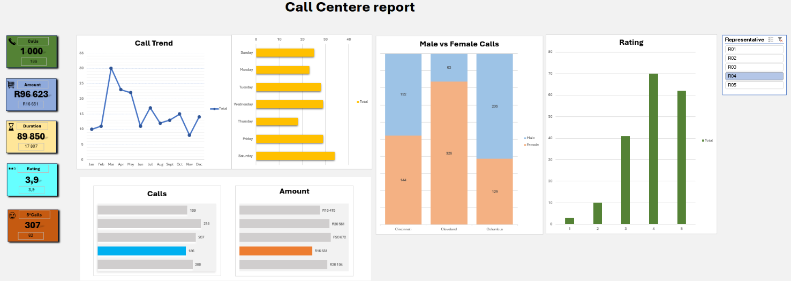

# Call Center Data Analysis

An interactive Excel dashboard that analyzes call center performance: call volume, revenue, duration, customer ratings, and agent activity.



## Overview

The dashboard turns raw call center records into one view that managers can use to monitor performance and spot trends. It shows:

- Call volume over time and by weekday
- Call distribution by country and gender
- Customer rating distribution
- Calls and revenue by representative

## Key Metrics

| Metric | Value |
|--------|-------|
| Total Calls | 1,000 |
| Total Amount | R96,623 |
| Total Duration | 89,850 |
| Average Rating | 3.9 |
| Streak | 397 |

## Dashboard Components

- **KPI cards:** calls, amount, duration, rating, streak
- **Call Trend:** monthly line chart
- **Calls by weekday:** bar chart
- **Male vs Female Calls:** stacked chart by country
- **Rating distribution:** column chart of ratings 1 to 5
- **Calls and Amount rankings:** bar charts by representative
- **Representative slicer:** click to filter the dashboard by agent (see [Usage](#usage))

## Tools

Microsoft Excel: PivotTables, PivotCharts, slicers, and dashboard design.

## Repository Contents

```
├── Call Centere Data Analysis.xlsx   # Data, pivots and dashboard
├── dashboard.png                     # Dashboard screenshot
└── README.md
```

## Usage

1. Download or clone this repository.
2. Open `Call Centere Data Analysis.xlsx` in Excel. The dashboard is interactive, so it must be opened in Excel (not a GitHub preview) to work.
3. Go to the dashboard sheet.
4. **Interact with the Representative slicer** in the top-right corner:
   - Click a name to filter every chart and KPI card to that representative.
   - Hold `Ctrl` and click to select several representatives.
   - Click the clear-filter icon (funnel with a red X) on the slicer to reset to all representatives.
